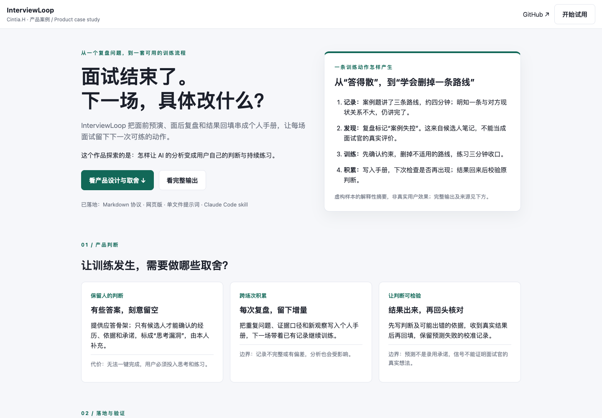

**中文 ｜ [English](#interviewloop--self-training-system-for-interview-candidates)**

# InterviewLoop · 让每场面试成为下一场的训练材料

**一个从真实面试复盘问题出发，落地为协议、个人手册和可用工具的产品实践。**

作者：[Cintia.H](https://github.com/cintiahuang123-ai) · 面向愿意持续复盘的求职者 · 当前重点：验证复盘方法与使用体验

[**看产品案例与演示 →**](https://interviewloop-cn.github.io/interviewloop/web/demo.html) ｜ [直接试用](#开始你的一场训练) ｜ [开发者接入](#开发者接入)

[](https://interviewloop-cn.github.io/interviewloop/web/demo.html)

## 从什么问题出发

面试结束后，记得自己答了什么，不等于知道下一场该改什么。一次性的 AI 建议也很难告诉你：同一个问题是否反复出现，上次的判断有没有被真实结果验证。

InterviewLoop 把一次问答延伸成一条可以持续积累的训练链路：

**面前对齐岗位与证据 → 面后定位问题 → 结果出来后校验判断 → 带着手册进入下一场。**

## 一个例子：把“我答得有点散”变成下一次的训练动作

以下摘自[仓库的虚构案例](example/loop-sample.md)，为便于理解做了摘要，不是用户实测效果：

| 环节 | 案例里发生了什么 |
|---|---|
| 面后笔记 | 候选人在案例题中讲了三条路线，约四分钟；意识到其中一条与对方现状关系不大，仍然讲完了 |
| 复盘发现 | 输出标记“案例失控”，并注明依据来自候选人笔记；不能据此断言面试官的真实评价 |
| 下一次练什么 | 先确认约束，再分路线；删掉与当前场景无关的路线，练习三分钟收口 |
| 怎样积累 | 把本次观察写入手册，下次看是否再次出现；真实结果回来后，再检验之前的判断 |

[查看五行结论卡和背后的完整证据 →](https://interviewloop-cn.github.io/interviewloop/web/demo.html#evidence)

## 产品取舍：为什么这样做

| 需要解决的问题 | 已落地的设计 | 接受的代价与边界 |
|---|---|---|
| AI 写出的完整答案，未必是候选人自己的判断 | 输出回答骨架；涉及个人判断的位置保留 `【空位·思考漏洞】` | 用户必须补充、练习，不能一键得到完整答案 |
| 每场复盘独立，难以发现重复问题 | 个人手册记录失分模式、证据口径与每场增量 | 需要持续记录；输入质量影响结论质量 |
| 事后容易把结果解释成“早就知道” | 先记录预测及可能出错的依据，再用模块 C 回填真实结果 | 预测只是待校验的判断，不是录用承诺 |
| 行业判断容易被套用到所有岗位 | 分类库允许“未分类”，输出保留来源与自检 | 当前分类源于中国互联网社招的小样本，泛化能力仍需验证 |
| 同一种方法需要在不同环境里使用 | 同一份 Markdown 协议，提供单文件提示词、网页版、Claude Code skill | 不同入口的自动化程度不同；网页版需要自备模型 API key |

## 已做出来什么，验证到了哪里

- **已交付：** 中文主协议、分类库、个人手册模板；虚构的六场手册和一轮完整示例；单文件提示词、静态网页版与 Claude Code skill。可直接查看和试用。
- **作者自测：** 按项目已有记录，作者用三场真实面试试跑，发现一个重复出现的失分模式；结果预测有一场出错。它是早期问题线索，不足以证明能提高面试通过率。
- **展示反馈：** [一位完整阅读演示的读者](https://github.com/ruanyf/weekly/issues/12071#issuecomment-6031510046)指出行业材料密集、难以迁移到自身岗位。本次展示因此先解释通用问题与训练动作，再提供完整案例。
- **下一步验证：** 陌生读者能否说清工具的价值和第一步；求职者能否完成一次使用，并在下一场真正执行一条训练动作。尚不宣称已获得规模化验证。

[阅读协议](PROTOCOL.md) · [查看六场手册](example/handbook-sample.md) · [查看迭代方向](ROADMAP.md)

## 开始你的一场训练

**不需要安装或 API key 的起点：** 打开 [单文件提示词](PROMPT.zh.md)，复制内容或下载文件，交给你常用的模型聊天应用；附上 JD 全文和简历要点，发送“运行模块 A”。模型可能有自己的使用限制或费用。

| 你现在的阶段 | 准备什么 | 这一步得到什么 |
|---|---|---|
| 面试前 · A | JD 全文 + 简历要点；有手册也一起提供 | 岗位与证据对照、回答骨架、待你补充的思考空位 |
| 面试后 · B | 面后笔记或转录；可附预案与手册 | 五行结论卡、依据、下一次训练重点与手册增量 |
| 收到结果 · C | 通过 / 未通过 / 走到第 N 轮 / 未知 | 结果回填，必要时更新校准记录 |

也可以[打开网页版](https://interviewloop-cn.github.io/interviewloop/web/)（自备 API key）。先想看输出，就[看示例](https://interviewloop-cn.github.io/interviewloop/web/demo.html)，无需输入个人材料。

## 用之前先看这三条

**需要你参与训练。** 面前预演需要 JD 和简历，复盘需要面试记录，思考空位需要你补充。输出帮助你安排训练，不能代替实际练习。

**只对愿意对自己诚实的人有用。** 工具无法防止你给自己写有利的笔记。它的每一条判断只和你给它的笔记一样好，它记的每一个计数都是你自己填的。这是前提，不是漏洞。

**支持哪些文本。** 模块 A 吃 JD 全文和简历要点；模块 B 吃面后笔记（按模板填）和转录（可选，有转录才能用 `[原话]` 标签）；模块 C 吃一行结果。三个模块都可以附上你的个人手册。

**本地保存，模型分析需要发送输入。** 网页版把手册和设置保存在浏览器，通过 Markdown 导出 / 导入备份，不经过项目自建后端。运行分析时，相关输入直接发送到你配置的模型服务商，API key 用于该请求的身份验证。使用聊天应用时，材料也会发送给该应用；请按需脱敏。

## 开发者接入

产品本体是一份 markdown 协议。四种用法，从轻到重：

| 用法 | 要准备什么 | 适合谁 |
|---|---|---|
| [看示例](https://interviewloop-cn.github.io/interviewloop/web/demo.html) | 什么都不用 | 想先知道它输出什么 |
| [单文件提示词](PROMPT.zh.md) | 一个你常用的大模型聊天应用 | 不想装东西、没有 API key。把文件上传到 Kimi、DeepSeek、豆包、通义千问、智谱、ChatGPT 或 Claude，发一句"运行模块 A"加 JD 和简历 |
| [网页版](https://interviewloop-cn.github.io/interviewloop/web/) | 一个模型 API key | 想要本地保存手册、离线查看资料、导入导出 |
| Claude Code skill | Claude Code | 想要录音本地转录、自动生成笔记草稿、自动写回手册 |

**Claude Code skill**

```
npx skills add interviewloop-cn/interviewloop
```
装好后在任意目录说"帮我准备这场面试"并给 JD，"复盘今天的面试"并给笔记、转录或录音，或者"走到第 2 轮"。skill 把手册放在 `~/InterviewLoop-workspace/handbook.md`，录音本地转录，从转录生成笔记草稿且每个计数都附原句出处，每次增量直接写回手册。

**任意模型，手动喂**

1. 把 `PROTOCOL.md` + `taxonomy/cn/` 五个文件 + 你的个人手册（如有）+ 本场输入，一起给模型。
2. 把模型输出的"手册增量"合并进你的 `handbook.md`。
3. 结果出来后跑模块 C。它写回一行；预测错了，再加一条校准记录。

三个模块的输入输出：

| 模块 | 你给 | 你得到 |
|---|---|---|
| A · 面前预演 | JD 和简历要点（都必填）、（手册） | 错位拦截、JD↔证据映射、面试官类型预判、5 分钟核对单、QA 预案（结构 + 一句结合简历的参考句）、带标记的自介半成品；可选追问链路预演，模型只追问不评分 |
| B · 面后复盘 | 面后笔记，或转录，或录音，或口述回忆（缺什么只问什么）、（手册）、（模块 A 输出） | 类型判定、链路对照与跨轮对照、失分模式追踪、先填信号表再预测、手册增量 |
| C · 结果回填 | 一行字：通过 / 未通过 / 走到第 N 轮 / 未知 | 写回一行，必要时一条校准记录 |

`SKILL.md` 是 Claude Code skill 的入口，只负责加载协议、管理本地工作区和写回手册，本身不含判断规则。

`web/` 下的网页是协议的一个客户端：选模型接口、填你自己的 API key（只存浏览器）、跑三个模块。页面与资料加载、缓存后可离线查看；调用远程模型或语音接口仍需联网。分析请求直接发往你配置的服务商。

### 网页版支持哪些模型

| 接口 | 在设置里怎么选 | Base URL |
|---|---|---|
| Claude | Anthropic | 内置 |
| DeepSeek | OpenAI 兼容接口 → 预设 DeepSeek | `https://api.deepseek.com/v1` |
| Kimi（月之暗面） | 预设 Kimi | `https://api.moonshot.cn/v1` |
| 通义千问（阿里云百炼） | 预设 通义千问 | `https://dashscope.aliyuncs.com/compatible-mode/v1` |
| 豆包（火山方舟） | 预设 豆包 | `https://ark.cn-beijing.volces.com/api/v3` |
| 智谱 GLM | 预设 智谱 | `https://open.bigmodel.cn/api/paas/v4` |
| OpenAI 及其他兼容接口 | 预设 OpenAI 或手填 | 自填 |

以上接口均允许浏览器直接调用（2026-09 逐个实测预检请求）。key 只存在你的浏览器里，请求从你的浏览器直达模型服务商。模型名更新很快，请到对应平台控制台复制当前可用的模型名。协议很长、规则很严，建议用各家当前最强的模型。

### 把网页安装成应用（PWA）三步

1. 用浏览器打开：`https://interviewloop-cn.github.io/interviewloop/web/`（Chrome / Edge / Safari 均可）。仓库根目录会自动跳转。
2. 选择**安装**（桌面端：地址栏的安装图标；iOS Safari：分享 → 添加到主屏幕；Android Chrome：菜单 → 安装应用）。
3. 从桌面或主屏幕打开。缓存的页面和资料可离线查看；远程 AI 分析需要联网。

## v1.0 边界

- **一位候选人，不分社招校招，面试官一人或多人。** 群面、无领导小组不覆盖：评分看组内相对表现，你给不出其他候选人的应答。校招特有的面试官类型需要持续录入样本，按贡献与反馈程度迭代。
- **只有一个市场包：`cn`。** 分类库源于中国互联网社招。英文文件是翻译加文化注释，不是独立市场包。海外市场包的启动条件：该市场累计 ≥10 场按贡献模板提交的记录。
- **分类库是种子不是全集。** 来自单一职能的小样本。"未分类"是合法输出，硬套不是。

## 仓库结构

```
PROTOCOL.md         主协议（中文，唯一主版本）
PROTOCOL.en.md      英文版，文件头标注对应的中文版本号
SKILL.md            Claude Code skill：工作区、路由、本地转录、手册写回
scripts/            transcribe.py（本地 whisper）、metrics.py（语速、填充词密度、最长单答）、check_quotes.py（[原话] 逐字核对）
GLOSSARY.md         zh↔en 术语表，全仓库翻译统一查表
taxonomy/cn/        面试官类型、骨架、信号、失分模式、业务阶段（market: cn）
taxonomy/en/        cn 的翻译，附 Cultural notes
templates/zh|en/    个人手册、面后笔记、贡献模板
example/            虚构候选人（骨科植入物临床市场），六场面试，一轮完整 A→B→C；SOURCES.md 列出行话与量级的公开校准来源
PROMPT.zh.md / PROMPT.en.md   零安装单文件提示词（由 scripts/build_prompt.py 生成）
web/                静态页 + PWA（index.html、demo.html 示例页、app.js、md.js、sw.js、manifest）
docs/               README 用图
index.html          跳转到 web/
LICENSE             CC BY-SA 4.0
ROADMAP.md
```

## 反馈

最想听到三类意见，按价值排序：

1. **方法论质疑**：你面过人，觉得某条判断不成立。[提一条质疑](https://github.com/interviewloop-cn/interviewloop/issues/new?template=method-challenge.yml)，最好带一个脱敏的反例。
2. **试用反馈**：你跑过一次，哪一步卡住，哪条输出是废话。[写试用反馈](https://github.com/interviewloop-cn/interviewloop/issues/new?template=trial-feedback.yml)。
3. **设计取舍**：比如"空位不让 AI 代填"值不值。去 [Discussions](https://github.com/interviewloop-cn/interviewloop/discussions) 聊。

反馈不需要写代码，也不需要装任何东西：[示例页](https://interviewloop-cn.github.io/interviewloop/web/demo.html)三十秒看完就能提。

## 贡献

只收 `taxonomy/` 的 PR，走 `templates/` 里的固定模板。禁公司名、人名、评价性语言。转录片段可以提交，但要去掉人名与公司名。模板字段本身就是脱敏边界。不承诺合并节奏。

## 关于本仓库的脱敏

仓库内不出现任何真实公司、人名、真实业务数字，包括作者自己的。所有样本均为虚构，行业与作者无关；行话与数量级按 `example/SOURCES.md` 里的公开资料校准。

---

# InterviewLoop · Self-Training System for Interview Candidates

**A product case study: turning an interview-review problem into a protocol, a personal handbook and working tools.**

By [Cintia.H](https://github.com/cintiahuang123-ai). [Explore the product case and demo (Chinese)](https://interviewloop-cn.github.io/interviewloop/web/demo.html) · [Try the single-file prompt](PROMPT.en.md)

Chinese is the canonical version. The English overview below summarizes the design and usage; the protocol and examples have their own version notes.

## The problem and a concrete example

Remembering an interview does not necessarily tell you what to practise next. Isolated AI advice also makes it difficult to see repeated problems or check earlier judgements against real outcomes.

InterviewLoop connects **preparation → review → outcome backfill → the next interview**, carrying the record forward in a personal handbook.

In the repository's **fictional example**, a candidate spends about four minutes presenting three approaches, including one they already suspect is irrelevant. The review flags the issue based on the candidate's notes and proposes a practice action: clarify constraints, remove irrelevant approaches and rehearse a three-minute answer. The observation goes into the handbook for later comparison. This illustrates the workflow; it is not evidence of real-world effectiveness.

## Product decisions and trade-offs

| Problem | Implemented decision | Cost or limit |
|---|---|---|
| Generated answers may bypass the candidate's own thinking | Provide answer structures and leave personal judgements as explicit blanks | The candidate must fill them and practise |
| Separate reviews lose recurring patterns | Track observations and evidence in a persistent handbook | Record quality affects analysis quality |
| Hindsight can obscure earlier mistakes | Record a judgement and its uncertainty, then backfill the actual result | Predictions are not hiring guarantees |
| A small taxonomy may not generalize | Allow unclassified cases and retain sources and self-checks | The taxonomy starts from a small Chinese internet-industry sample |
| Users work in different environments | Share one protocol across a prompt file, web app and Claude Code skill | Automation and setup requirements differ |

## Delivered and still to validate

The repository includes the protocol, taxonomy, handbook templates, a fictional six-interview handbook, a full sample loop and three usable entry points. The author's existing self-report describes three real interview trials: one repeated pitfall was identified, and one outcome prediction was wrong. That is an early signal, not proof of improved interview success.

A reader [reported difficulty understanding the dense industry example](https://github.com/ruanyf/weekly/issues/12071#issuecomment-6031510046). The showcase now introduces the transferable problem and practice action before exposing the full evidence. Next to validate: whether a newcomer can understand and complete a first use, and carry an action into their next interview.

## Read this before you use it

**It is not a shortcut.** This workflow requires your participation: the JD and your résumé are both required, the post-interview notes are yours to write, and the blanks are yours to fill. If you want something that answers for you, this is the wrong tool.

**It only works for people willing to be honest with themselves.** The tool cannot stop you from writing notes that flatter you. Every judgement it makes is only as good as the notes you give it, and every count it keeps is a count you filled in. This is a precondition, not a loophole.

**What text it takes.** Module A takes the JD and your résumé points; Module B takes post-interview notes (on the template) and, optionally, a transcript (the `[VERBATIM]` tag is only available with one); Module C takes a one-line result. All three can carry your personal handbook.

**Local storage, remote analysis.** The web app stores your handbook and settings in your browser and has no project-operated backend. Running analysis sends relevant input directly to your configured model provider, using your API key for authentication. Uploading material to a chat app sends it to that service too. Export Markdown for backups and redact sensitive inputs as needed.

## How to use it

The product is a markdown protocol. Four ways to use it, lightest first:

| Way | What you need | For whom |
|---|---|---|
| [See the sample](https://interviewloop-cn.github.io/interviewloop/web/demo.html) | nothing | you want to know what it outputs |
| [Single-file prompt](PROMPT.en.md) | a chat app you already use | no install, no API key: upload the file to ChatGPT, Claude, DeepSeek, Kimi… and say "Run Module A" with the JD and your résumé |
| [Web app](https://interviewloop-cn.github.io/interviewloop/web/) | one model API key | local handbook storage, offline, import and export. Works with Claude and any OpenAI-compatible endpoint: DeepSeek, Kimi, Qwen, Doubao, GLM and OpenAI all allow direct browser calls (verified 2026-09) |
| Claude Code skill | Claude Code | local transcription of recordings, notes drafted from the transcript, automatic handbook write-back |

**Claude Code skill (recommended)**

```
npx skills add interviewloop-cn/interviewloop
```
Then, in any directory, say "prepare me for this interview" with the JD, "debrief today's interview" with your notes, transcript or recording, or "reached round 2". The skill keeps your handbook at `~/InterviewLoop-workspace/handbook.md`, transcribes recordings locally, drafts your notes from the transcript with every count sourced to a verbatim line, and writes each increment back to the handbook.

**Any model, by hand**

1. Give the model `PROTOCOL.md` + the five files in `taxonomy/cn/` + your handbook (if you have one) + this interview's input.
2. Copy the increment the model outputs into your `handbook.md`.
3. After the outcome is known, run Module C. It writes back one row and, if the prediction was wrong, one calibration record.

Three module inputs:

| Module | You provide | You get |
|---|---|---|
| A · Pre-interview Rehearsal | JD and résumé points (both required), (handbook) | mismatch intercept, JD ↔ evidence map, type forecast, 5-minute pre-interview checklist, QA plan (structure plus one reference sentence built from your résumé), a three-tag self-intro draft; optional follow-up chain rehearsal where the model only asks |
| B · Post-interview Review | post-interview notes, or a transcript, or a recording, or spoken recall (the tool asks only for what is missing), (handbook), (Module A output) | type judgement, follow-up chain and cross-round comparison, pitfall tracking, signal table → outcome prediction, handbook increment |
| C · Outcome Backfill | one line: pass / fail / reached round N / unknown | one row written back, calibration record if needed |

`SKILL.md` is the entry point of the Claude Code skill: it loads the protocol, manages your local workspace and writes increments back to the handbook. It contains no judgement rules of its own.

The web page under `web/` is one client of the protocol: pick a model endpoint, paste your own API key (stored only in your browser), and run the three modules. Cached pages and reference material can be viewed offline; remote model and speech requests require a connection and go directly to your configured provider.

### Install the web page as an app (PWA)

1. Open the page in a browser: `https://interviewloop-cn.github.io/interviewloop/web/` (Chrome, Edge or Safari). The repository root redirects there.
2. Choose **Install** (desktop: the icon in the address bar; iOS Safari: Share → Add to Home Screen; Android Chrome: menu → Install app).
3. Open it from your desktop or home screen. Cached pages and material are available offline; remote AI analysis requires a connection.

## Scope of v1.0

- **One candidate, experienced hire or campus, with one or more interviewers.** Group interviews and leaderless discussions are not covered: their scoring rests on relative performance and you cannot supply the other candidates' answers. Campus-specific interviewer types need continued sample intake and iterate with contributions and feedback.
- **One market package: `cn`.** The taxonomy was written from interviews in the Chinese internet industry. English files are translations with cultural notes, not a separate market package. An overseas package starts only after that market has ≥10 interview records submitted through the contribution template.
- **The taxonomy is a seed, not a census.** It came from a small sample in one job function. "Unclassified" is a valid output; forcing a match is not.

## Repository layout

```
PROTOCOL.md         main protocol (Chinese, canonical)
PROTOCOL.en.md      English translation, header cites the Chinese version
SKILL.md            Claude Code skill: workspace, routing, local transcription, handbook write-back
scripts/            transcribe.py (local whisper), metrics.py (speaking rate, filler density, longest answer), check_quotes.py (verbatim-quote check)
GLOSSARY.md         zh↔en term table; all translation goes through it
taxonomy/cn/        interviewer types, skeletons, signals, pitfalls, stages (market: cn)
taxonomy/en/        translation of cn/ with cultural notes
templates/zh|en/    handbook, post-interview notes, contribution templates
example/            a fictional candidate (orthopaedic-implant clinical marketing), six interviews, one full A→B→C run; SOURCES.md lists the public data the jargon and magnitudes are calibrated against
PROMPT.zh.md / PROMPT.en.md   no-install single-file prompt (generated by scripts/build_prompt.py)
web/                static page + PWA (index.html, demo.html sample page, app.js, md.js, sw.js, manifest)
docs/               images for the README
index.html          redirects to web/
LICENSE             CC BY-SA 4.0
ROADMAP.md
```

## Feedback

Three kinds of input are wanted most, in order of value:

1. **Challenge the method**: you have interviewed people and think a rule does not hold. [Open a challenge](https://github.com/interviewloop-cn/interviewloop/issues/new?template=method-challenge.yml), ideally with an anonymised counter-example.
2. **Trial feedback**: you ran it once; where did you stall, which output was noise. [Write trial feedback](https://github.com/interviewloop-cn/interviewloop/issues/new?template=trial-feedback.yml).
3. **Design trade-offs**: for example, whether refusing to let the AI fill the blanks is worth it. Talk in [Discussions](https://github.com/interviewloop-cn/interviewloop/discussions).

Feedback needs no code and no install: the [sample run](https://interviewloop-cn.github.io/interviewloop/web/demo.html) takes thirty seconds.

## Contributing

Only `taxonomy/` accepts pull requests, through the fixed templates in `templates/`. No company names, no personal names, no evaluative language. Transcript excerpts are accepted once names and company names are removed. The template fields are the anonymisation boundary. There is no promised merge cadence.

## Privacy note on this repository

No real company, person or business figure appears anywhere in this repository, including the author's own. Every example is fictional, in an industry the author has never worked in; its jargon and orders of magnitude are calibrated against public sources listed in `example/SOURCES.md`.
